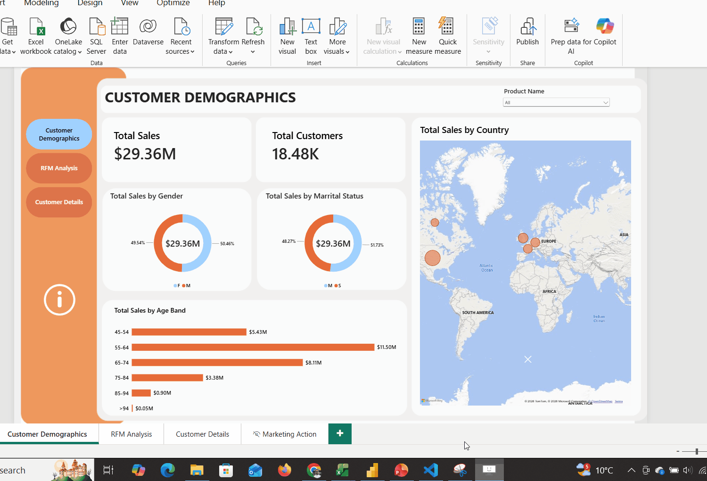

# Customer Analytics & RFM Segmentation

> Segmenting about 18,500 customers by how recently, how often and how much they buy, so marketing team can target each group with the right action.

<br>



**Tools:** Excel · Power BI · DAX 


---
## Overview
This case study simulates a customer analytics environment within an retail company.

The project is based on **DAAG**, a fictional retail company created to reproduce a realistic business scenario and demonstrate how rfm analytics can support marketing decisions.

The objective is to build a complete customer analytics dashboard, from business understanding and rfm segmentation to customer insights and reporting.

## Business problem
**How can DAAG combine purchasing behaviour and customer characteristics to identify meaningful customer groups and run more targeted marketing actions?**

Not every customer is worth the same effort. A shop that sends the same email to everyone wastes money on people who have left and under-serves its best buyers.

This project answers three questions:
- Who are our most valuable customers?
- Which customers are about to leave?
- What should marketing do for each group?
## Recommendations
**1. Win back high-value customers before they are lost**<br>
**At Risk** and **Cannot Lose Them** together account for about **38% of revenue**.
Run a personal win-back campaign for these two segments, with VIP offers and direct outreach. At about **$1,900 of past value per customer**, even a small recovery rate pays for the campaign.

**2. Turn one-time buyers into repeat buyers**<br>
**63% of customers ordered only once** and brought in just **23% of revenue**.
Send a follow-up series after the first purchase, with a second-order discount and product suggestions based on what they bought. Moving even a small share of these customers to a second order is the biggest growth lever in the data.

**3. Tailor the strategy by global market**<br>
The **USA and Australia** bring in about **63% of revenue**, but in different ways.
Protect Australian customers with loyalty and retention offers. In the USA, grow the average spend per customer through bundles and upselling.

## Key insights
**1. A small group drives a large share of revenue**<br>
**Champions** are about **9% of customers** but bring in about **28% of revenue**.<br>

**2. A large share of revenue is at risk**<br>
**At Risk** and **Cannot Lose Them** together account for about **38% of revenue**. *Cannot Lose Them* alone holds about **2,050 customers worth $3.9M** in past revenue, about $1,900 per customer. These customers used to spend heavily but have stopped buying.<br>

**3. Even one more purchase matters**<br> 
**11,619 out of 18,484** customers placed **only one order** and bring in just **23% of revenue**. While **two-time buyers** generate almost **55% of revenue**. Repeat buyers spend about **$3,294** on average, compared with **$581** for one-time buyers. That's about **5.7 times more**.<br>

**4. New customers are many but low value so far**<br> 
**New Customers** are the largest segment, with about **17% of customers**, but they bring in under **1% of revenue**. They are the main group to convert into repeat buyers.<br>

**5. Two markets carry the business**<br> 
**USA** and **Australia** bring in about **63% of revenue**. The USA wins on volume, with **42% of customers**. Australia wins on value: its customers spend about **$2,523 each**, roughly **twice** the US figure of **$1,201**.<br>

**6. The business is healthy at the margin**<br> 
Total revenue is **$29.36M** (excluding tax and freight). After product costs, gross profit is about **$12.08M**, a gross margin of about **41%**.

## Table of contents
1. [Business problem](#business-problem)
2. [Recommendations](#recommendations)
3. [Key insights](#key-insights)
4. [What is RFM?](#what-is-rfm)
5. [Dataset](#dataset)
6. [Method](#method)
7. [Customer segments](#customer-segments)
8. [Dashboard walkthrough](#dashboard-walkthrough)
9. [Repository structure](#repository-structure)
10. [How to run it](#how-to-run-it)
11. [Limitations and next steps](#limitations-and-next-steps)
12. [Contact](#contact)

---

## What is RFM?
RFM scores every customer on three simple behaviours:

| Letter | Meaning | Question it answers | Measured as |
|---|---|---|---|
| **R** | Recency | How recently did they buy? | Days since last order |
| **F** | Frequency | How often do they buy? | Number of distinct orders |
| **M** | Monetary | How much do they spend? | Total sales amount |

Each letter gets a score from 1 (worst) to 5 (best). The three digits together form a code, such as **545**. The code is then mapped to a named segment, such as **Champions**.

## Dataset
AdventureWorksDW is a sample data warehouse from Microsoft for a fictional bike company.

| Table | Rows | Used for |
|---|---|---|
| `FactInternetSales` | 60,398 | Orders, dates and sales amounts |
| `DimCustomer` | 18,484 | Customer names and details |
| `DimGeography` | 655 | Country and city |
| `DimProduct` | 606 | Product details |
| `DimDate` | 2,191 | Calendar |
| `RFM_Table.xlsx` | 125 codes | Maps each RFM code to a segment |

## Method

**1. Calculate R, F and M per customer**
- Recency uses a fixed reference date of **2008-08-01**. That is the day after the last order in the data.
- Frequency counts distinct `SalesOrderNumber` values, not order lines.
- Monetary sums `SalesAmount`.

**2. Score each value from 1 to 5**
Customers are ranked and split into five equal groups (quintiles). For recency, fewer days scores higher.

**3. Build the RFM code and map it to a segment**
`RFM Score = R × 100 + F × 10 + M`, then joined to the segment lookup table.

<details>
<summary>DAX used</summary>

```dax
Recency Value =
VAR RefDate = CALCULATE ( MAX ( FactInternetSales[OrderDate] ), ALL ( FactInternetSales ) ) + 1
RETURN DATEDIFF ( MAX ( FactInternetSales[OrderDate] ), RefDate, DAY )

Frequency Value = DISTINCTCOUNT ( FactInternetSales[SalesOrderNumber] )

Monetary Value = SUM ( FactInternetSales[SalesAmount] )

RFM Table =
ADDCOLUMNS (
    SUMMARIZE ( FactInternetSales, FactInternetSales[CustomerKey] ),
    "Recency Value", [Recency Value],
    "Frequency Value", [Frequency Value],
    "Monetary Value", [Monetary Value]
)

R Score =
VAR Rnk = RANKX ( 'RFM Table', 'RFM Table'[Recency Value], , DESC )
RETURN ROUNDUP ( 5 * Rnk / COUNTROWS ( 'RFM Table' ), 0 )
-- F Score and M Score follow the same pattern with ASC
```
</details>

The SQL version of the same logic is in [`sql/rfm_scores.sql`](sql/rfm_scores.sql).

<!-- TODO: add a screenshot of your data model (Model view) -->


## Customer segments

| Segment | Who they are | Marketing action | Customers |
|---|---|---|---|
| Champions | Buy often, recently, and spend the most | Reward with loyalty perks and early access | TODO |
| Loyal | Regular, high-value buyers | Upsell and ask for reviews | TODO |
| Potential Loyalist | Recent buyers with growing frequency | Offer a membership or loyalty programme | TODO |
| Promising | Recent buyers with low spend | Build the relationship with onboarding offers | TODO |
| New Customers | Bought recently for the first time | Welcome series and second-purchase offer | TODO |
| Need Attention | Average on all three | Limited-time offers based on past purchases | TODO |
| About To Sleep | Engagement is dropping | Re-engagement email with a reminder | TODO |
| At Risk | Used to buy often, now quiet | Personal win-back offer | TODO |
| Cannot Lose Them | Big spenders who stopped buying | VIP outreach and strong incentive | TODO |
| Hibernating | Long inactive, low value | Low-cost reactivation campaign | TODO |
| Lost | Inactive, low value on every score | Exclude from paid campaigns | TODO |

<!-- TODO: fill the Customers column from your dashboard -->

## Dashboard walkthrough
<!-- One screenshot and two or three lines per page -->

**Page 1: Overview**

KPI cards for total customers, revenue and average order value. Customers and revenue by segment.

**Page 2: Segment detail**

Customer table with R, F and M scores. Segments are color-coded from green (best) to red (worst) with conditional formatting.

**Page 3: TODO**
<!-- e.g. geography, product categories, or trends over time -->


## Repository structure
```
rfm-segmentation/
├── data/
│   ├── AdventureWorksDW.xlsx
│   └── RFM_Table.xlsx
├── sql/
│   └── rfm_scores.sql
├── powerbi/
│   └── RFM_Dashboard.pbix
├── images/
│   └── (screenshots)
└── README.md
```

## How to run it
1. Clone this repository.
2. Open `powerbi/RFM_Dashboard.pbix` in Power BI Desktop.
3. If prompted, point the data source to the files in `data/`.
4. Click **Refresh**.

To run the SQL version, restore AdventureWorksDW in SQL Server and run `sql/rfm_scores.sql`.

## Limitations and next steps
- **Ties in frequency.** About 63% of customers placed only one order, so frequency separates customers less well than recency and spend.
- **Static scores.** The RFM table is a calculated table, so scores don't change with report slicers.
- **Sample data.** Adventure Works is synthetic, so the findings show the method rather than real business results.

Next steps:
- Try K-means clustering on R, F and M and compare it with the rule-based segments.
- Track how customers move between segments over time.
- Add customer lifetime value (CLV).

## Contact
**Tanvir**, MSc Data Science, IT University of Copenhagen
<!-- TODO: LinkedIn · portfolio · email -->
